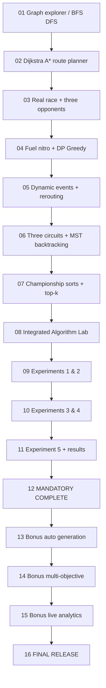
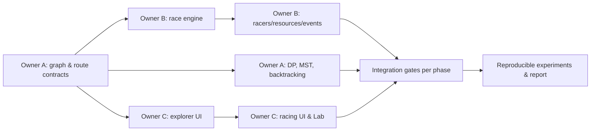

# Smart Racing Championship — Detailed Implementation Plan

**Project:** Smart Racing Championship: The Algorithmic Racing Challenge  
**Course:** Design and Analysis of Algorithms  
**Source of truth:** `Project.pdf`, 14 pages, Sections 1–9; reviewed in full  
**Deadline in assignment:** **05 December 2026, 11:59 PM**  
**Target platform:** Windows 10/11; Python 3.12+, Pygame; three student developers; Codex-assisted development where permitted  
**Plan status:** Proposed implementation roadmap; **not evidence that any feature has been implemented**  
**Goal:** Deliver every mandatory requirement, five reproducible studies, a complete submission, and all three advanced/bonus challenges.

> **Important:** This plan targets the stated requirements, not a guaranteed grade. The PDF contains no numerical grading rubric. A working early checkpoint can earn credit for completed functionality, but **only the mandatory-complete checkpoint** is intended to satisfy *all mandatory* requirements. The three advanced challenges are designated extension/bonus work unless the instructor says otherwise. Check any separate course policy on AI-assisted development and third-party libraries; the PDF requires group contribution, understanding, and acknowledgement of permitted external assets.

---

## 0. Operating principles: every phase is a real demo

### 0.1 What counts as a phase

A phase is **not** complete when code merely compiles or unit tests run. It is complete only when its new capability can be **launched, seen, interacted with, measured, and explained**, on top of all earlier accepted phases.

Every phase must produce:

1. **Running vertical slice:** `python -m smart_racing` launches the current integrated game, and the phase's feature is reachable from the UI (or an explicitly linked in-app benchmark/track-editor tool).
2. **Visible demonstration:** a named menu path, scenario, input, and expected on-screen result; no mock data presented as finished functionality.
3. **Automated evidence:** relevant unit and integration tests; deterministic fixtures; repeatable smoke command.
4. **Manual evidence:** recorded short demo (video/GIF/screenshots) plus a clear reproduction script in `docs/demos/PHASE_##.md`.
5. **Report-ready evidence:** pseudocode/complexity or mechanics explanation, counters/results, assumptions, and limitations relevant to that phase.
6. **Emergency snapshot:** tagged, protected `main` commit or release candidate containing its complete, *truthfully documented* current features and no known fatal startup failures.
7. **Three-person handoff:** assigned student agents update their handoffs, open issues/PRs, and can explain that milestone without relying on an agent.

**A phase is cumulative, not a standalone package disconnected from previous phases.** Any accepted phase must remain runnable from a fresh clone after installing dependencies. Never merge an unlaunchable partially integrated phase to `main`.

### 0.2 Branching, PRs, and merges

```text
main  (protected, reviewed, green; last demonstrable emergency checkpoint)
  ^  phase acceptance / promotion PR (game -> main)
game  (protected, shared integration, always runnable)
  ^  individual reviewed PRs targeting game
feature/<issue>-<scope>   or   stacked branches on an unmerged prerequisite
```

- **Critical-path (C) tasks:** must finish in specified order or depend on another task/phase; never start dependent implementation against invented contracts.
- **Parallel (P) tasks:** can be built concurrently against *approved, versioned* contracts or fixture files. They may still have explicit merge prerequisites.
- **Integration (I) tasks:** join the parallel work; usually unblock the actual on-screen demo. They are on the critical path if a phase cannot be released without them.
- Each task has an **ID**, owner role, dependency, tangible output, and verifiable acceptance condition. Create one GitHub issue per ID; reference issue IDs in PRs.
- A stacked PR is reviewed as a dependency chain; merge **base first**, retarget/rebase children, rerun CI, obtain fresh review if required. Do not merge code with unresolved dependency branches.
- **One different teammate's approval** is the project review minimum for PRs into `main`; prefer the same for `game` if available. Branch-rule enforcement depends on GitHub repository plan/visibility and must be verified, not assumed.
- The final integration PR for each phase must include: `docs/demos/PHASE_##.md`, tests, README/run updates, demo evidence, and phase-specific acceptance checklist. Mark `[ ]` only after actual checks pass.

### 0.3 Three-person parallel ownership (rename roles to actual members later)

| Role | Primary responsibility | Secondary/parallel responsibility | Reviews |
|---|---|---|---|
| **A — Algorithms & data** | Graph, BFS/DFS, Dijkstra/A*, resource optimization, MST/backtracking, instrumentation | Algorithm Lab contracts, experiments 1–3 | Reviews B's PRs |
| **B — Simulation & rules** | Racing lifecycle, deterministic opponents, fuel/nitro consumption, event heap, scoring/sorts/top-k | Invariants, game integration tests, experiments 4–5 | Reviews C's PRs |
| **C — UI, tooling & evidence** | Pygame menus/screens, track visuals, interactive Lab/benchmark viewer, build/CI, report | Circuit fixtures, UI smoke tests, demo recordings | Reviews A's PRs |

These are **primary accountable owners, not exclusive file ownership**. The assignment says *all members must contribute and understand the complete implementation.* Rotate teaching/review duties, and require all three students to demonstrate a feature authored by another member before final submission. Where A/B/C dependencies conflict, owners coordinate on interface PRs first; avoid parallel editing of the same files.

### 0.4 The required user-facing screens (all five eventually accessible)

1. **Main Menu:** Championship, Quick Race, Algorithm Lab, instructions/settings.
2. **Track Explorer / Route Planner:** rendered graph; reachable checkpoints; alternative paths; route lengths/time/cost and comparisons.
3. **Racing Screen:** cars moving legally on graph edges; checkpoints, fuel, nitro, lap/time, road/events.
4. **Algorithm Lab:** step-through algorithms on the current real track/data with operation counters; **must call the exact functions gameplay uses**.
5. **Championship Dashboard:** results, sortable standings, statistics, full ranking and top-k.

Before a screen's real functions exist, its button may be shown as **clearly disabled: "Coming in Phase N"**, never as a fake completed feature. Every phase still supplies at least one *working* interactive UI and a working main entry point.

### 0.5 Stable developer/run commands (create gradually; once present, preserve them)

```powershell
# Windows PowerShell, from repository root after dependency installation
py -3.12 -m venv .venv
.\.venv\Scripts\Activate.ps1
python -m pip install -e ".[dev]"
python -m smart_racing
python -m smart_racing --smoke       # headless one-cycle app smoke, added Phase 01
python -m pytest -q
python -m smart_racing --validate-tracks   # added Phase 06
python -m smart_racing --benchmark all     # added Phase 11
```

For CI Pygame tests, use a dummy SDL video driver and deterministic fixture clocks/event inputs. `--smoke` is **not** a substitute for manual GUI inspection. Do not introduce a command until it is actually implemented; document its availability by phase. Preserve `pyproject.toml` as the primary packaging/dependency authority, keeping `requirements.txt` consistent.

---

## 1. Requirements interpretation, edge cases, and scope boundaries

### 1.1 Mandatory vs bonus — avoid losing marks through misclassification

| Requirement | Mandatory interpretation | Bonus expansion |
|---|---|---|
| **Prim or Kruskal** | Implement one, use it to build an **undirected MST backbone** for track configurations; demonstrate it in functional track tooling (PDF §§5.4, 6). | Generate whole new circuits on demand (§8 challenge 1). |
| **Backtracking** | Implement constraint-based checkpoint/service/obstacle placement or track generation, with pruning and validation; give it an operational track-building role (§§5.4, 6). | Full automatic candidate generation, rejection examples, and playable generated track (§8 challenge 1). |
| **Route presets** | Normalize non-negative distance/time/fuel/difficulty/obstacle costs; Balanced/Speed/Economy/Safety presets; *at least one circuit where presets change route* (§3.3). | Expanded multi-objective comparison, trade-off explanation and detailed side-by-side visualization (§8 challenge 2). |
| **Priority queue / top-k** | Deterministic race events and top-k championship retrieval with correct comparator (§§4.5, 5.5, 6). | Live top-k updates and performance comparisons (§8 challenge 3). |
| **DP** | 0/1 Knapsack **and/or** refuelling DP, with actual feasible resource recommendations (§§5.3, 6). | Implementing *both* models is a quality enhancement; refuelling DP is called a recommended extension, not one of the three formal §8 bonus tasks. |
| **Algorithms** | All 12 named families/techniques, with gameplay or game-tool role and shared Algorithm Lab code (§§1, 6). | Do **not** rely on a disconnected demonstration algorithm to claim integration. |

**Grading uncertainty:** The document defines minimums and extensions, but not numeric percentages. These phases aim at compliance, not a forecast of marks.

### 1.2 Freeze these project decisions in `docs/architecture/RULES_AND_ASSUMPTIONS.md` before race code

Decisions below are **proposed implementation choices** when the PDF permits discretion; do not describe them as required values unless indicated.

- **Graph:** adjacency lists `O(V+E)`; vertex: `id, x, y, type, checkpointOrder, active`; edge: `id, from, to, distance, baseTime, fuelCost, difficulty (1..5), status, isShortcut, directed`; mutable edge/service state without rebuilding graph.
- **Route cost:** `cost(e) = wd·D(e) + wt·T(e) + wf·F(e) + wr·R(e) + wo·O(e)` after documented normalization; all components/weights non-negative; on-screen cost exactly equals optimization cost. Restricted-edge effective cost must be reflected.
- **A*:** admit only heuristics proven non-overestimating for the *actual weighted scalar cost*. Use a consistent lower bound (or `h=0` when no valid positive lower bound); document consistency/reopening policy and verify cost equality with Dijkstra.
- **Checkpoints:** at least 10 per circuit, in assigned order, repeated every lap. A lap/finish only counts after ordered progress and crossing the documented lap boundary; early/unordered visitation never advances incorrectly.
- **Races:** choose **2 laps** as default (PDF suggests 2 or 3); all racers start at start vertex with full tank and configured initial nitro. Use **deterministic simulation time** (fixed update steps), separate from rendering frame rate and wall-clock benchmark time.
- **Movement:** cars remain on legal edge segments. Define explicitly how an edge closure affects a car *already traversing* the edge (proposed policy: finish the committed segment, then reroute at the next vertex; no new entry into a blocked edge). Handle waits/DNF rather than freezing. This is a design decision, not a PDF rule.
- **Fuel:** proposed max `100`; consumption per edge = base `fuelCost × [1 + 0.1 × (difficulty − 1)]`; refuel up to `40` per stop with fixed stop time when buying `>0`, subject to capacity/availability.
- **Nitro:** max `3` charges; one charge means `1.5×` speed for `4` simulation seconds and `2×` fuel over the affected portion. Compute partial-edge effects without double charging; carry remaining nitro duration across edge boundaries.
- **AI:** 3 rule-based deterministic opponents, **no ML/RL**: (1) fixed main route + prescribed detour, (2) shortcut-preferred + fallback, (3) shortest-distance + nearest reachable fuel station when below 25%. Respect all common checkpoint/fuel/road rules.
- **Recovery:** one documented, consistent policy across racers; e.g. wait a finite, counted amount if a scheduled reopening is known, otherwise reroute or DNF. Avoid indefinite waiting and report elapsed-time accounting. Do not assume a universally applicable policy is specified by the PDF.
- **Event order:** min-heap key `(triggerTime, priority, insertionSequence)`; lower priority number first; process **all same-time events** before route recalculation; cancellation by lazy deletion; independent overlapping temporary effects with deterministic expiry and recomputation.
- **Scoring:** positions 1–10 award `25,18,15,12,10,8,6,4,2,1`. Finish times tie by lower racer ID. Championship tie-breaks: (1) more wins, (2) lower sum of finish positions, (3) lower best fastest-lap time, (4) lower racer ID. Decide and document whether timeout/DNF earn points; do not change policy after experiments.
- **Records/metrics:** model `Racer`, `RaceResult`, `ChampionshipEntry`, `Event`; expose algorithm results **with instrumentation and optional trace** without building a different algorithm for the Lab.
- **Track data:** authoritative versioned JSON with explicit schemas; game, validation, Lab and benchmarks load the same authored/generated circuits. Seed all randomized generators; default AI and events deterministic.
- **Report:** log actual rule tuning, exact normalization references/weights, tie conventions, limits, library acknowledgements, and chosen benchmark measurement scope.

### 1.3 Architecture / shared contracts to avoid incompatible parallel PRs

```text
JSON circuits + validated graph model
          |
          +--> Algorithms (pure Python functions + metrics + trace)
          |       +--> BFS/DFS, Dijkstra/A*, DP/Greedy, MST/Backtracking
          |       +--> heaps, Merge/Quick/Heap Sort and top-k
          |
          +--> Race simulation (fixed time, racers, resources, events)
          |       +--> championship results + ordering
          |
          +--> Pygame presentation/controller
          |       +--> main menu / explorer / race / Lab / dashboard
          |
          +--> Experiments (headless harness calls SAME algorithm modules)
```

Suggested public contracts (document and merge before dependent parallel work):

- `TrackGraph` read/traverse/update edges and service vertices; `validate_track(track) -> ValidationReport` with precise reasons.
- `RouteRequest`: graph snapshot, source, target, cost preset, next checkpoint; `RouteResult`: ordered vertex/edge path, total distance/time/fuel/scalar cost, status, counters, optional trace.
- `AlgorithmTraceStep`: algorithm, step index, event category, current element, visited/frontier/state snapshot, metrics. Trace **observes** the production algorithm, not a second implementation.
- `RacerState`: position *on edge*, progress to next checkpoint/lap, fuel, nitro, elapsed simulated time and status; immutable-ish snapshots for UI.
- `RaceEvent`: ID, type, trigger time, priority, insertion sequence, target, duration, canceled; active effects tracked by unique IDs.
- `RaceResult/ChampionshipEntry` and a single shared `compare_championship_entries(a,b)` total-order policy used by all 3 sorts and top-k.
- `ExperimentRecord`: experiment ID, seed, graph/input size, algorithm, configuration, counters, duration ns, run ID, machine/runtime metadata, pass/fail.

**Interface gate:** Owner A proposes data/algorithm contracts; B and C review them before code from other branches consumes the interface. Changes to shared interfaces require contract tests and a dependent-PR checklist.

---

## 2. Roadmap: runnable milestones and emergency value

| Phase | New *working* user-facing feature | Key assignment coverage | Emergency submission value |
|---|---|---|---|
| **01** | Interactive graph explorer: BFS/DFS, reachability, cycles/dead ends | Act 1; partial Main Menu/Explorer | Exploratory algorithm visualizer, runnable with 1 track |
| **02** | Dijkstra/A* route planner, checkpoint legs and route presets | Act 2; weighted cost | Interactive route optimization game-tool |
| **03** | Drive a race vs 3 rule-based opponents, checkpoint/lap validation | Basic Act 4 game rules, racing GUI | **First playable racing game** |
| **04** | Fuel, nitro, stations, DP vs Greedy recommendation | Act 3; actual resource gameplay | Playable strategic racing with optimization |
| **05** | Deterministic road/event system with live rerouting | Act 4 heap/events/closures | Playable *dynamic* racing game |
| **06** | 3 valid tracks + MST/backtracking track construction tool | Mandatory track minimum, MST/backtracking | Three-track game, all core graph-generation algorithms |
| **07** | Full championship, standings, 3 sorts, top-k | Act 5, Dashboard | **Complete championship loop** |
| **08** | Fully integrated Algorithm Lab and counters for all 12 | Five screens; same-code visualization | Complete mandatory algorithm *demonstration* |
| **09** | Interactive experiment results for BFS/DFS and Dijkstra/A* | Experiments 1–2 | Two reproducible algorithm studies |
| **10** | DP/Greedy and event-heap experiment results | Experiments 3–4 | Four reproducible studies |
| **11** | Sorting/top-k study, study browser and results package | Experiment 5; all five reports/datasets | **All five studies complete** |
| **12** | Audited, runnable, tested, packaged baseline + full technical report | **All mandatory deliverables** | **MANDATORY COMPLETE — safe submission baseline** |
| **13** | Generate/preview/race new valid circuit and rejected example | Advanced challenge 1 | Bonus track-generation demo |
| **14** | Side-by-side multi-objective route analysis and trade-offs | Advanced challenge 2 | Bonus route analytics demo |
| **15** | Live championship top-k heap analytics with comparison | Advanced challenge 3 | **All three bonus challenges** |
| **16** | Final acceptance, Windows executable, report update, ZIP rehearsal | Submission §9 and viva | **FINAL BONUS-ENHANCED RELEASE** |

**Partial-credit note:** A runnable phase demonstrates *some* marks-relevant work but does not necessarily satisfy the PDF's whole submission. Do not label Phase 07 or 08 "fully compliant" before the experiment reports, validation, packaging and testing are done.

### 2.1 Critical-path dependency graph



This diagram is the **safe main-branch promotion order**, *not* a claim that all implementation tasks must be sequential. Parallel feature branches can start earlier against stable contracts; for example, track fixtures, UI design, test datasets and experiment harnesses can develop while the related engines are under construction. Do not wait for Phase 08 to write tests or collect counters: those are required in every phase.

### 2.2 Parallel workstreams (example)



### 2.3 Universal per-phase release gate

Every phase's final PR includes a `PHASE_##_ACCEPTANCE.md` checklist with:

- [ ] Fresh Windows clone installs and launches `python -m smart_racing`.
- [ ] Phase-specific menu path works on real data; no dead buttons or fabricated demo outcomes.
- [ ] All previously delivered screens/features still work.
- [ ] At least one positive test, one negative/boundary test, one relevant integrated test, and one deterministic-replay test when randomness/events are involved.
- [ ] Algorithm invariants/complexity and gameplay rules recorded where relevant.
- [ ] A passing `python -m pytest -q` run and CI status actually verified.
- [ ] Manual on-screen demo steps, expected output, and captured evidence attached.
- [ ] No known crash, hang, infinite loop, or broken return-to-menu path.
- [ ] GitHub issues/PR links, responsible team members, changed contracts, handoffs and limitations documented.
- [ ] `game` promoted into protected `main` via reviewed PR; create `checkpoint/p##-<slug>` tag/release if permitted.
- [ ] Emergency ZIP rehearsed as applicable, clearly listing completed/not-yet-completed assignment requirements.

---

## 3. Detailed phase implementation backlog

Legend: **C = critical ordered task**, **P = parallel candidate**, **I = integration/release critical**.  
"Depends" names the upstream *task* or accepted *phase*. A parallel task still needs any listed contract/fixture before merge.  
Task owners **A/B/C** are the role allocations from §0.3, not GitHub usernames.

### PHASE 01 — Launchable Circuit Explorer: graph model + BFS + DFS

**Deliverable:** Open the Pygame app, select **Track Explorer**, see a graph drawn as vertices/edges, choose any start and destination, click **BFS** or **DFS**, watch the traversal/path highlight, see reachable checkpoints, cycle/component/dead-end analysis and an unreachable message.

**Emergency demonstrator:** A genuine algorithm-driven graph navigation application, even though the racing loop is not yet implemented. Document that it only covers Act 1.

| ID | Lane / owner | Depends | Implementable task + observable acceptance |
|---|---|---|---|
| **01-C01** | C / A | Existing scaffold | Freeze graph schema, directed/undirected neighbor semantics, edge IDs, vertex types and reference fixtures in architecture docs; review with B/C. |
| **01-C02** | C / A | 01-C01 | Implement adjacency-list graph, import JSON, data validation, neighbor/edge lookup and read-only graph snapshot; invalid duplicate IDs, negative weights/difficulty out of range rejected with friendly errors. |
| **01-C03** | C / A | 01-C02 | Implement production **BFS** using queue/visited/parent with reachability and fewest-edge path; returns actual edge path and visited/examined counters; deterministic neighbor order. |
| **01-C04** | C / A | 01-C02 | Implement production **DFS** with visited/discovery tracking, cycle detection (correctly handle undirected parent edge), connected components, dead-end checks and bounded simple alternative paths; enforce configurable path-count/length limits. |
| **01-P01** | P / C | 01-C01 | Draw graph coordinates, node/edge legend and clickable start/destination selection; overlay visited/frontier/path from production trace data. No separate BFS/DFS copy in UI. |
| **01-P02** | P / B | 01-C01 | Build fixture JSONs: connected/cyclic, branching/dead-end, disconnected, directed/undirected and single-vertex; include BFS 1-edge-vs-shorter-distance counterexample (S–T length 10 vs S–A–B–T length 6). |
| **01-P03** | P / B | 01-C01 | Write graph/BFS/DFS tests: minimum edge count, components, cycles, unreachable/source=target, dead-end definition, simple-path limit, zero/one-node cases. |
| **01-P04** | P / C | Existing scaffold | Make working Main Menu, Explorer navigation, help/legend, back button, `__main__.py`, `--smoke` and headless launch tests; unfinished screen entries visibly disabled. |
| **01-I01** | I / C+B | 01-C03, 01-C04, 01-P01..04 | Integrate actual BFS/DFS outputs into the Explorer and establish shared trace/counter contract. Verify visual highlights match returned vertex/edge paths. |
| **01-I02** | I / A+B+C | 01-I01 | Record demo, run CI/tests and fresh-clone smoke; merge into `game`, review/promote to `main`, document partial coverage. |

**Show the examiner:** Main Menu → Explorer → connected circuit → BFS path → DFS traversal/cycle/dead end → disconnected fixture → "unreachable"; press Back, no crashes.  
**Must pass:** BFS shortest number of edges (not shortest weighted distance), O(V+E) traversal, bounded exponential alternative-path enumeration, test cases from PDF §5.1.  
**Evidence:** screen recording, BFS/DFS test logs, printed visited/examined counters, `docs/demos/PHASE_01.md`.  
**Phase exit:** Runnable Explorer with two real, tested algorithms and documented limitations.

### PHASE 02 — Route Planner: Dijkstra + A* + checkpoint-aware routing + cost presets

**Deliverable:** In Explorer, choose route origin/destination and compare BFS, Dijkstra and A*; select Balanced/Speed/Economy/Safety; see at least two alternative routes, scalar costs/distances/estimated times, ordered checkpoint legs and immediate updates when a road is manually blocked/restricted.

**Emergency demonstrator:** Working interactive weighted routing system and checkpoint planner, even if no car moves yet.

| ID | Lane / owner | Depends | Implementable task + observable acceptance |
|---|---|---|---|
| **02-C01** | C / A | Phase 01 | Freeze normalized D/T/F/R/O formulas, positive reference values, preset weights, restriction/obstacle effects and scalar-cost API; prove non-negativity and define tie policy. |
| **02-C02** | C / A | 02-C01 | Implement **Dijkstra** (non-negative weights, binary min-heap) with parent reconstruction, edge exclusions, source=target, unreachable and relaxation/heap counters. |
| **02-C03** | C / A | 02-C01, 02-C02 | Implement **A*** with provably admissible/consistent weighted heuristic or safe `h=0`; document no-reopen or reopen policy; output same optimal scalar path cost as Dijkstra in valid cases. |
| **02-C04** | C / A | 02-C02..03 | Implement route legs through ordered mandatory checkpoints and finish using current racer/progress state; never award checkpoint progress out of order; reroute from current graph state. |
| **02-P01** | P / C | 02-C01 | Build route comparison panel: selected preset, visited/frontier animation, candidates, total scalar cost, physical distance/fuel/time, heap operations and alternative-route legend. |
| **02-P02** | P / B | 02-C01 | Create a **10-checkpoint sample circuit** with 2 designated shortcuts, at least one cycle/dead end, services and roads with varied difficulty; design at least one cost-weighted fork where route choice differs across presets. |
| **02-P03** | P / B | 02-C01 | Define manually triggered Block/Open/Restricted editor actions for Explorer and graph mutation tests; postpone automatic event scheduling until Phase 05. |
| **02-P04** | P / B | 02-C01 | Build routing fixtures: zero-weight edge, blocked bridge, equal-cost paths, very long path, unreachable endpoint, distance vs scalar divergence, non-negative cost invariant. |
| **02-I01** | I / A+C | 02-C04, 02-P01..03 | Wire Dijkstra/A* from production route module to UI, cost presets and manual graph changes; same displayed scalar cost is optimized by engine. |
| **02-I02** | I / A+B+C | 02-I01, 02-P04 | Run Dijkstra/A* differential tests on known graphs, verify checkpoint order and immediate reroute; evidence and review promotion to `main`. |

**Show:** Change Speed to Economy/Safety and observe different valid route; close a route edge and see new optimal path or explicit no-route; demonstrate multiple ordered checkpoint legs.  
**Must pass:** Dijkstra optimality on non-negative graphs; A* optimal cost equality under documented assumptions; `O((V+E) log V)` Dijkstra implementation; bounded alternate-route search; exact cost display; counters for future Experiment 2.  
**Evidence:** reproducible route fixture screenshots, Dijkstra/A* counter CSV, heuristic derivation and tests.  
**Phase exit:** A usable route-planning screen based on four graph algorithms, with immutable public route contracts for the race engine.

### PHASE 03 — First playable race: graph-legal movement, laps, 3 deterministic AI opponents

**Deliverable:** Click **Quick Race**, drive a car on legal edges against three distinguishable computer opponents, cross ten checkpoints in order over two laps, and get a real results screen with finish times or DNF. This is the **first emergency deliverable that is visibly a racing game**.

| ID | Lane / owner | Depends | Implementable task + observable acceptance |
|---|---|---|---|
| **03-C01** | C / B | Phase 02 | Freeze race rules, racer state machine, fixed simulation timestep, graph-edge progress, checkpoint/lap boundary, tie-breaks, finish/DNF and max race duration; agree inputs/outputs with A/C. |
| **03-C02** | C / B | 03-C01 | Implement deterministic race loop independent from Pygame: spawn racers, advance legal edge traversal, interpolate car position for rendering, advance simulation clock and record result state. |
| **03-C03** | C / B | 03-C02 | Enforce ordered `checkpointOrder` and lap boundary; early/skipped checkpoint cannot count, correct next checkpoint displayed, finish only after full laps. |
| **03-C04** | C / B | 03-C02, 03-C03 | Implement all three specified AI policies: fixed route/detour; shortcut when open/fallback; shortest-distance route and future refuel hook (fully enforced in Phase 04). No ML/random strategy decisions. |
| **03-P01** | P / C | 03-C01 | Build Racing Screen: edge-bound car sprites/markers, HUD with position, lap, next checkpoint, elapsed time, controls/pause/restart; clearly mark fuel/nitro as not yet enabled instead of pretending. |
| **03-P02** | P / A | 03-C01 | Provide stable route-leg adapter between game engine and shared path algorithms; avoid algorithm duplication and illegal next-checkpoint skipping. |
| **03-P03** | P / A | 03-C01 | Create opponent route fixtures for fixed/shortcut/shortest-distance behavior and blocked-route fallback interface. |
| **03-P04** | P / C | 03-C01 | Implement Quick Race selection and finish/results screen; navigable back to menu; input help for keyboard controls. |
| **03-I01** | I / B+C | 03-C02..04, 03-P01..04 | Connect player keys to legal graph choices and 3 AI competitors to one shared engine; show four car markers moving; complete a race to real result times and positions. |
| **03-I02** | I / A+B+C | 03-I01 | Test replay determinism, times/ID tie breaks, illegal shortcut, missed checkpoint, multiple laps, time-limit ranking, restart; stage demo/review to `main`. |

**Show:** Start Quick Race → choose turns at intersections → watch three strategy-labelled opponents → fail an out-of-order checkpoint attempt → complete lap 1/lap 2 → see standings.  
**Must pass:** cars remain on graph edges, identical input/event fixtures yield identical AI outputs, no silent infinite wait, complete-race and DNF coverage.  
**Phase exit:** A simple but real playable 2D top-down racing game. Fuel/nitro/event mechanics are explicitly marked pending.

### PHASE 04 — Strategic racing: fuel, nitro, stations, DP/Greedy resource planner

**Deliverable:** Race HUD shows actual fuel/nitro; refuel at stations and collect boosters; nitro visibly speeds the car and increases fuel consumption; pre-race Planner compares **0/1 Knapsack DP** vs **Greedy** recommendations and highlights selected pickups on the map.

| ID | Lane / owner | Depends | Implementable task + observable acceptance |
|---|---|---|---|
| **04-C01** | C / B | Phase 03 | Implement shared fuel/boost rules: tank 100, edge difficulty factor, maximum 40 units per station stop, stop-time charge, max 3 nitro, 1.5× for 4 simulated seconds, 2× fuel during boost. |
| **04-C02** | C / B | 04-C01 | Integrate resource state with edge traversal, fractional/partial nitro duration and station/pickup activation, insufficient fuel stop and documented DNF/recovery; enforce same rules for player/AI. |
| **04-C03** | C / A | 04-C01 | Define item cost/benefit semantics and integer/scaled budget; implement **0/1 Knapsack DP** with reconstruction, valid `dp[0][b]` base and selected pickup IDs. |
| **04-C04** | C / A | 04-C03 | Implement **Greedy** positive-benefit zero-cost handling, zero/zero policy, benefit/cost ordering, deterministic ratio tie and feasible selection. |
| **04-C05** | C / A+B | 04-C02..04 | Feasibility filter: proposed detours and pickups must respect actual route availability, tank, station availability, pickup once, nitro cap and resource distinction; unsafe planner recommendation is rejected/explained. |
| **04-C06** | C / B | 04-C02 | Complete the 3 deterministic AI refuel policies: opponents 1 and 2 use first eligible station below 25% fuel; opponent 3 uses nearest reachable station on route below 25%; share tank/stop-time legality with human racer. |
| **04-P01** | P / C | 04-C01 | Resource HUD: gauge, boost timer, charges, station prompt, refill cost/time, empty-fuel state; visual difference with/without nitro. |
| **04-P02** | P / C | 04-C03 | DP/Greedy comparison panel: item cost, benefit, ratio, budget, selected pickups, total benefit, DP state count and highlighted map route. |
| **04-P03** | P / A | 04-C03 | DP exhaustive-search oracle for small instances, initial PDF A(6,30), B(5,24), C(5,24), budget 10; create two distinct additional greedy-suboptimal cases and tests. |
| **04-P04** | P / B | 04-C01 | Test full tank, exact edge-fuel boundary, empty tank, station unavailable, 40-unit cap, pickup unavailable, nitro duration across multiple segments and impossible route. |
| **04-P05** | P / A | 04-C01 | Optional quality enhancement: implement refuelling DP on fixed-route discrete states `dp[j][f]`, transition capacity/40-unit cap, and compare feasible stopping time; mark as extension, do not block mandatory Phase 04 unless team explicitly accepts scope. |
| **04-I01** | I / A+B+C | 04-C05..06, 04-P01..04 | Integrate planner's actual DP/Greedy selected results with playable circuit pickup/station entities and racer state. Show feasible recommendations executed in a race. |
| **04-I02** | I / A+B+C | 04-I01 | Record DP vs Greedy counterexample and fuel/boost demo; verify same mechanic for all four racers; promote checkpoint. |

**Show:** Plan with budget 10 → Greedy benefit 30 vs DP benefit 48 (B+C) → race to pickup → activate nitro and see 1.5× speed + extra fuel use → refuel → intentional low-fuel DNF.  
**Must pass:** resource planner never suggests impossible route/tank/pickup; discrete cost scaling disclosed; DP pseudo-polynomial `O(mB)` and reconstruction; benchmark counters available.  
**Phase exit:** Real resource-constrained racing plus two functioning optimization techniques.

### PHASE 05 — Live road network: event min-heap, deterministic changes and rerouting

**Deliverable:** During a real four-car race, scheduled road blocks, shortcut toggles, oil spills, speed caps, fuel station availability and nitro pickups visibly modify the track. A road closure invalidates a planned route, triggering Dijkstra/A* replanning or documented recovery **without restarting the race**.

| ID | Lane / owner | Depends | Implementable task + observable acceptance |
|---|---|---|---|
| **05-C01** | C / B | Phase 04 | Freeze event schema, 6 event types, trigger priority (blockage 1; shortcut 2; oil 3; speed cap 4; station 5; booster 6), insertion sequence, clear/restore model and deterministic scheduling API; use documented approximate durations (oil 20s, speed cap 15s, station availability 30s, nitro booster 25s or until collected; blockage/shortcut until explicitly reversed). |
| **05-C02** | C / B | 05-C01 | Implement a real **binary min-heap event queue**, keyed `(triggerTime, priority, insertionSequence)`; `push`, `peek`, `pop`, cancel by lazy deletion; count comparisons/swaps/heap operations. |
| **05-C03** | C / B | 05-C02 | Implement deterministic event application/expiry; drain **all events sharing a timestamp** in heap order *before* route recalculation; target validation and clear error/rejection handling. |
| **05-C04** | C / B | 05-C03 | Implement independently tracked overlapping effects by event ID (oil/speed restrictions); recompute effective edge condition using documented combination order, not simply undo last event; schedule expiries deterministically. |
| **05-C05** | C / B+A | 05-C03..04 | Trigger route invalidation and recalculation from current racer state; reject blocked edges, recompute restricted costs, apply consistent mid-edge and wait/recovery/DNF policies. |
| **05-P01** | P / C | 05-C01 | Display event timeline, current active effects, upcoming event, map markers (blocked red, restricted orange), countdowns and reroute reason in Racing Screen. |
| **05-P02** | P / C | 05-C01 | Provide a deterministic test-event scenario selection screen before a race, including simultaneous events, overlapping restrictions and forced no-route scenario. |
| **05-P03** | P / A | 05-C01 | Event test oracle with stable event ordering, cancellation, multiple same-time events and independent expiry; assert one effect expiring cannot erase another. |
| **05-P04** | P / A | Phase 04 | Build integration fixtures with an optimal main route, viable detour, and unrecoverable graph cut; verify replanned paths remain checkpoint-legal and fuel-feasible. |
| **05-P05** | P / B | 05-C02 | Collect heap insert/extract counters and timestamp/sequence trace for Experiment 4, without introducing rendering into benchmark functions. |
| **05-I01** | I / A+B+C | 05-C05, 05-P01..04 | Attach event queue to race engine, graph state and HUD; verify road blockage causes visible route change while cars continue racing. |
| **05-I02** | I / A+B+C | 05-I01 | Play recorded event-sequence twice and compare final state/positions/time/finish order; verify lazy-deleted events are skipped; promote to `main`. |

**Show:** Start prepared "Dynamic Track" scenario → event list fires two simultaneous events in priority order → main route becomes blocked → car takes a legal detour → oil + speed cap overlap and independently expire → fuel station closes → optionally force a DNF.  
**Must pass:** six event types; `O(log n)` insertion/extraction and `O(1)` peek; deterministic tie ordering; no crashes on missing targets; no illegal post-blockage route; cancellation/expiry behavior.  
**Phase exit:** A live dynamic racing game with genuinely integrated heap/events/routing.

### PHASE 06 — Three valid circuits + track validator + MST/backtracking construction tool

**Deliverable:** Quick Race and Explorer offer **three visually distinct playable topologies**, each with 10 ordered checkpoints, 2+ shortcuts, alternative roads, intersections, a cycle and a dead end, services and dynamic-event targets. The **Track Workshop** shows an MST backbone built with Prim *or* Kruskal and backtracking placement of constraints, with validation messages; successful constructed configurations can be saved/played.

**Why this is mandatory:** §§5.4 and 6 expressly require both MST backbone and backtracking. The more autonomous random track generator is separated into Phase 13 as bonus.

| ID | Lane / owner | Depends | Implementable task + observable acceptance |
|---|---|---|---|
| **06-C01** | C / A+B | Phase 05 | Freeze track validator rules: unique IDs, correct types, directed edges, legal weights/status, ≥10 ordered checkpoints, ≥2 shortcuts, cycle, dead end, intersections, alternative routes, service placement, lap return and feasible fuel plan. |
| **06-C02** | C / A | 06-C01 | Implement `validate_track` for data/graph structural constraints and ordered directed reachability per lap/return; report **specific reasons**, not just a boolean. Do not confuse weak connectivity with directed reachability. |
| **06-C03** | C / A | 06-C01 | Implement **one** correct MST method (recommend **Kruskal + union-find**, for explainability); reject/label disconnected undirected candidates as forest; output selected edges, weight and union-find/heap counters. |
| **06-C04** | C / A | 06-C02..03 | Build a connected undirected candidate graph; compute MST backbone; add extra edges for cycles/alternatives/shortcuts; introduce one-way roads **after** backbone and revalidate traversability. |
| **06-C05** | C / A | 06-C02..04 | Implement **backtracking** placement of checkpoints (order), stations, pickups and obstacles subject to spacing/degree/bridge/fuel constraints; use pruning, bounded retries and valid/invalid reason trace; explain worst-case exponential behavior. |
| **06-C06** | C / A+B | 06-C05 | Integrate candidate-generation/placement output into the **real circuit loader** and race validation; allow workshop-generated fixed-layout configurations to be launched as a Quick Race. |
| **06-P01** | P / C | 06-C01 | Author 3 distinct, visually coherent JSON circuits using actual edge coordinates/weights, with ≥10 checkpoints and ≥2 shortcuts each. Do not clone one graph and merely change its color. |
| **06-P02** | P / B | 06-C01 | Build automated circuit acceptance tests: ordered reachability all laps, one-way legality, lap return, full fuel plan, alternatives, cycle, dead end, service availability, dynamic-event legality and AI behavior. |
| **06-P03** | P / C | 06-C03..05 | Add Workshop screen inside Explorer/Tools: show candidate graph, MST highlighted, extra edges, backtracked placements, rejection reasons and Save/Play for valid result. |
| **06-P04** | P / B | 06-C01 | Write negative fixtures: disconnected candidate, MST forest, missing checkpoint, isolated checkpoint after one-way edge, impossible refuel, bridge removal, no alternative route, invalid shortcut. |
| **06-P05** | P / C | 06-C01 | Add circuit selection, mini-map, route highlight colors, checkpoint numbers and clear edge-status/one-way legends on all three tracks. |
| **06-I01** | I / A+B+C | 06-C06, 06-P01..05 | Validate all 3 tracks in CI, load each into Explorer/Race/Lab, complete a race on each, and show one valid MST/backtracking construction with actual race launch. |
| **06-I02** | I / A+B+C | 06-I01 | Run generated-invalid rejection, zero-reachable-route and long-cycle tests; attach validator report, video and review/promote. |

**Show:** Circuit selector → three different playable maps; workshop shows candidate → MST → extra edges → checkpoint/station/obstacle backtracking → validator → "Play this configuration"; reject a disconnected or infeasible candidate visibly.  
**Must pass:** all circuit minimums and full lap/return feasibility; MST not confused with forest, one-way validity retested, backtracking has pruning and explicit bounded failure, dynamic closures do not silently freeze.  
**Phase exit:** All three required circuits playable; mandatory MST and backtracking have a **functional track-construction use**, not just a lab-only animation.

### PHASE 07 — Championship mode + standings + Merge/Quick/Heap Sort + top-k

**Deliverable:** Main Menu → **Championship** starts a three-circuit sequence, completes races, awards points, updates a real Dashboard, lets the user switch ranking algorithms and choose `k` leaders, and declares the champion after the final race.

| ID | Lane / owner | Depends | Implementable task + observable acceptance |
|---|---|---|---|
| **07-C01** | C / B | Phase 06 | Freeze championship race sequence, scoring for positions 1–10, time ties/lap timeout/DNF policy and full total-order comparator; create `ChampionshipEntry` state and versioned result records. |
| **07-C02** | C / B | 07-C01 | Implement point allocation, wins, sum of finishing positions, best fastest-lap and championship progression; test 3 completed races → one consistent champion. |
| **07-C03** | C / A+B | 07-C01 | Implement **Merge Sort** using shared comparator, stable ordering and correct full ranking including all tiebreak levels. |
| **07-C04** | C / A | 07-C03 | Implement **Quick Sort** with documented pivot/partition (prefer 3-way duplicate handling); same ranking, expected-average and worst-case behavior documented. |
| **07-C05** | C / A | 07-C03 | Implement **Heap Sort** with shared comparator; same ranking, in-place ordering semantics and non-stability documented. |
| **07-C06** | C / B | 07-C03..05 | Implement **top-k** using size-k heap or heapify-and-extract with one shared comparator; correct for `k=0`, `k=1`, `k=n`, `k>n` documented and tested. |
| **07-P01** | P / C | 07-C01 | Dashboard: race result table, total points, wins, finishes, fastest laps, sort selector, top-k slider/input and champion banner. |
| **07-P02** | P / C | 07-C01 | Championship menu and flow: next race/circuit, progress bar, restart championship, replay results and return to menu. |
| **07-P03** | P / A | 07-C01 | Sorting fixtures for empty/singleton, sorted, reverse, random, duplicate-heavy and exact four-level tie case ending in racer ID. |
| **07-P04** | P / B | 07-C01 | Integration tests: all three circuit transitions, points carry over, same scores with no extra awards, DNF/time-limit behavior, restart cleanly. |
| **07-P05** | P / A | 07-C03 | Collect sort comparison/swap counts, top-k heap operations and raw result arrays for Experiment 5. |
| **07-I01** | I / B+C | 07-C02..06, 07-P01..04 | Complete championship from menu to final banner; alternate sort engines and top-k must show **identical** shared comparator ordering. |
| **07-I02** | I / A+B+C | 07-I01 | Demonstrate 1st=25, 2nd=18, 3rd=15, 4th=12; test full 10-racer points table using synthetic race results (game defaults to four); promote. |

**Show:** Race Circuit 1 → standings; Circuit 2 → points accumulate; Circuit 3 → champion; choose Merge/Quick/Heap → same order; choose top 2/3 → first `k` entries exactly.  
**Must pass:** all sorting techniques and top-k share one exact total comparator; 10-position table implemented even if UI normally has four racers; no duplicate standings rules.  
**Phase exit:** **Complete playable championship flow** with all three required sorting algorithms and top-k in functional use.

### PHASE 08 — Full integrated Algorithm Lab: live trace, stepping, counters and explainability

**Deliverable:** A complete **Algorithm Lab** reachable from Main Menu. Select **the current real circuit**, algorithm/technique, input parameters; press Step/Play/Pause/Reset; see frontier/selected vertices/DP table/heap tree/sorted bars/MST selection/backtracking decisions. Trace and result are produced by **exactly the algorithms already used by game, track tooling or standings**.

| ID | Lane / owner | Depends | Implementable task + observable acceptance |
|---|---|---|---|
| **08-C01** | C / A+B+C | Phase 07 | Audit actual call sites for all 12 families. For each, identify production module, real game/tool invocation, callable interface, trace/counter schema and Lab scenario; log missing integration as blocker. |
| **08-C02** | C / A | 08-C01 | Standardize optional trace/metrics adapter in algorithm modules (BFS, DFS, Dijkstra, A*, DP, Greedy, MST, backtracking); keep same code path with trace disabled in production when not needed. |
| **08-C03** | C / B | 08-C01 | Add event-heap step trace (trigger/priority/sequence/expiry) and championship sort/top-k operation traces without changing live engine ordering. |
| **08-C04** | C / C | 08-C02..03 | Implement Lab playback state machine consuming production traces: Step/Play/Pause/Reset/Speed, selects current circuit, validates algorithm input, displays counters and clearly differentiates measured vs illustrative values. |
| **08-P01** | P / C | 08-C01 | Create standardized viewers: graph canvas and queue/stack, shortest-path heap, DP grid/pickup selection, MST/placement map, heap timeline, sorting bars and top-k. |
| **08-P02** | P / A | 08-C01 | Prepare canonical expected input/result fixtures per algorithm (source/target, budget/items, candidate track, event list, championship data) using same data contracts as game. |
| **08-P03** | P / B | 08-C01 | Write identity tests that call each production function from Lab adapter and in-game component with identical fixtures and assert same result/counters/trace prefix. |
| **08-P04** | P / C | 08-C01 | Lab method sidebar: plain-English objective, inputs/outputs, correctness reason, time/space complexity, assumptions, typical edge case, gameplay integration link. |
| **08-P05** | P / A | 08-C01 | Audit exhaustive §6 checklist, record every algorithm's actual game invocation, test reference and complexity (BFS/DFS, Dijkstra/A*, DP, Greedy, Backtracking, MST, Heap, Merge/Quick/Heap Sort). |
| **08-I01** | I / A+B+C | 08-C04, 08-P01..05 | Live-demo **all 12** on data loaded from playable circuits, with step controls and counters; navigate directly to relevant screen/tool demonstrating its gameplay use. |
| **08-I02** | I / A+B+C | 08-I01 | Verify production and Lab results identical; forbid duplicate algorithm source files for display-only animation; capture 12-method evidence checklist and promote. |

**Show:** BFS/DFS on current circuit; Dijkstra/A* distances/counters; DP vs Greedy selected items; MST/backtracking placement; heap event order; Merge/Quick/Heap ranking; top-k. Use the *same entities* seen in the game.  
**Must pass:** all five required GUI screen functions now accessible; no detached implementations, trace shouldn't change result, Lab doesn't crash on missing/unreachable/empty inputs.  
**Phase exit:** Twelve mandatory algorithm families all demonstrated, integrated and viva-explainable through a single runnable game.

### PHASE 09 — Reproducible performance dashboard: Experiments 1 and 2

**Deliverable:** In **Algorithm Lab → Experiments**, select **Graph Traversal** or **Shortest Paths**, run a reproducible batch (or open the last measured dataset), see plots/tables and export CSV. Backed by actual *headless* measurements of production BFS/DFS/Dijkstra/A*.

| ID | Lane / owner | Depends | Implementable task + observable acceptance |
|---|---|---|---|
| **09-C01** | C / A+C | Phase 08 | Freeze common experiment schema: hardware/OS, Python version, package revision, graph/input seed, input generation, algorithm, warm-up, run count, time `perf_counter_ns`, counters, mean/median/std, correctness status; separate wall-clock/UI time. |
| **09-C02** | C / A | 09-C01 | Implement **Experiment 1** generator: multiple `(V,E)` sizes, sparse and denser graphs, fixed seeds, same input for BFS/DFS; record visited nodes, examined edges, runtime, cycle/components correctness. |
| **09-C03** | C / A | 09-C01 | Implement **Experiment 2** generator: varied sizes/circuits/coordinates, non-negative documented scalar costs, identical inputs for Dijkstra and A*; record time, expanded vertices, relaxed edges, heap operations, final cost. |
| **09-C04** | C / A | 09-C02..03 | For each size run warm-up then ≥5 timed repetitions by default; explicitly exclude rendering/file I/O/delays from timed region; document whether graph/heap initialization is included. |
| **09-P01** | P / C | 09-C01 | Lab Experiments panel: pick experiment and input sizes, show progress/results with clear time units and chart legends; load prior CSV without rerunning, export plot PNG and measurements CSV. |
| **09-P02** | P / B | 09-C01 | Write correctness-validation oracle outside measured interval: BFS min-hop vs independent reference for small cases; DFS cycle/component; Dijkstra/A* equal optimal cost under admissible heuristic. |
| **09-P03** | P / B | 09-C01 | Add benchmark safety: fixed seed, limits for large graphs, no GUI main-thread freeze, error reporting and no mislabeled empty results. |
| **09-P04** | P / C | 09-C01 | Build report template for Experiments 1–2 with objective, environment, generation, sizes, procedure, metrics, results/chart, interpretation, limitations, conclusion and theory-vs-measurement disclaimer. |
| **09-I01** | I / A+C | 09-C04, 09-P01..04 | Run and render both experiment panels; confirm CSV records reproduce numeric chart and contain all mandatory columns. |
| **09-I02** | I / A+B+C | 09-I01 | Independently rerun selected seed and compare correctness/counters (timing may vary); commit data, notes and evidence; promote. |

**Show:** Graph Traversal plot as V/E grows, sparse vs dense; Routing chart Dijkstra vs A* expansion counts and matching path cost; open raw CSV.  
**Must pass:** §7 Exp 1–2; do not claim A* always expands fewer vertices; actual runtime may be noisy, distinguish measured data from asymptotic complexity.  
**Phase exit:** Two complete experimental studies with reproducible raw files and graphical results visible inside the app.

### PHASE 10 — Experiments 3 and 4: DP/Greedy quality + event-heap determinism

**Deliverable:** Experiment panel provides **Resource Optimization** comparison with chosen items/benefits and **Event Queue** timing plots plus simultaneous/cancelled/expiry traces, using the same production DP/Greedy and heap functions as gameplay.

| ID | Lane / owner | Depends | Implementable task + observable acceptance |
|---|---|---|---|
| **10-C01** | C / A | Phase 09 | Implement **Experiment 3** varying item count and integer budget; benchmark DP and Greedy on the same instances; record selected items, achieved benefit, duration and DP state count. |
| **10-C02** | C / A | 10-C01 | Include assignment counterexample A(6,30), B(5,24), C(5,24), budget 10 (Greedy 30, DP 48); include **two original strict-gap cases** and verify DP against exhaustive search on small instances. |
| **10-C03** | C / B | Phase 09 | Implement **Experiment 4** varying event count; measure min-heap insertion and extraction separately, log operations and verify `(triggerTime, priority, insertionSequence)` ordering. |
| **10-C04** | C / B | 10-C03 | Exercise equal timestamps, priorities and sequence ordering; lazy cancellations, expiry, overlapping restrictions, missing-target handling with correctness checks separate from timed runs. |
| **10-P01** | P / C | 09-C01 | Extend Experiment UI for budget/size selection, DP/Greedy benefit gap, selected-item tables, event queue timelines and heap plots. |
| **10-P02** | P / A | 10-C01 | Add resource feasibility report rows: true detour cost, item availability, fuel capacity, nitro cap, impossible plan reason; no mixed-unit budget without documented conversion. |
| **10-P03** | P / B | 10-C03 | Add heap reference-order tests using an independent sorted expected list only as a test oracle (not production implementation); include cancellation and effect-expiry order. |
| **10-P04** | P / C | 09-C01 | Write reproducible experiment chapters 3–4 and chart captions: O(mB) pseudo-polynomial time; O(log n) heap operations; practical limitations of measurement. |
| **10-I01** | I / A+B+C | 10-C02, 10-C04, 10-P01..04 | Run both studies through Lab/CLI, inspect CSV and plots; validate production algorithms are exactly the measured functions. |
| **10-I02** | I / A+B+C | 10-I01 | Record visible DP counterexamples and event-tie demo; review/CI and promote. |

**Show:** Three named DP-vs-Greedy examples, selected items/benefit chart; queue insertion vs extraction as event count grows; replay equal-time/cancellation test and observe exact event order.  
**Must pass:** §7 Exp 3–4, five repeated runs after warm-up, counters, raw data, fully documented setup and limitations.  
**Phase exit:** Four of the five mandatory experimental studies are ready for marking.

### PHASE 11 — Experiment 5 + complete experiment viewer, reproducibility bundle

**Deliverable:** **Sorting and Top-k Study** appears alongside Experiments 1–4. Switch between random, sorted, reverse-sorted and duplicate-heavy inputs; compare Merge/Quick/Heap Sort and size-k heap top-k; export raw results and a coherent five-study experimental report annex.

| ID | Lane / owner | Depends | Implementable task + observable acceptance |
|---|---|---|---|
| **11-C01** | C / A+B | Phase 10 | Implement **Experiment 5** seeded `ChampionshipEntry` datasets across increasing `n` (synthetic benchmark n can exceed the four in-game racers; real scoring still supports 1–10); generate four prescribed order distributions. |
| **11-C02** | C / A | 11-C01 | Benchmark Merge/Quick/Heap Sort and full-sort vs size-k heap; vary `k` (small and close to `n`), record runtime/comparison counts where supported, same input and comparator. |
| **11-C03** | C / B | 11-C02 | Verify all full rankings byte-for-byte equal, top-k equals first k sorted entries, final racer-ID tiebreak case; use identical scoring and comparator as live Dashboard. |
| **11-C04** | C / A+C | 11-C01..03 | Unify benchmark command/runner and experiment metadata for all five; support `--benchmark all` with deterministic seeds, bounded workloads and nonzero exit on failed correctness. |
| **11-P01** | P / C | 09-C01 | Extend Experiment UI with sort distribution selector, k selection, timing/comparison plots, CSV download location and links to five result sections. |
| **11-P02** | P / C | 09-C01 | Create consolidated figures, input-size tables, raw measurement index and report annex containing all five required experiment structures. |
| **11-P03** | P / B | 09-C01 | Audit experiment fairness: same hardware/interpreter/options, warm-up, ≥5 runs per input, no rendering/I/O inside timed region, correctness checks outside timing, means + useful dispersion and measurement scope. |
| **11-P04** | P / A | 09-C01 | Audit theory statements: BFS/DFS O(V+E), shortest paths heap bounds/heuristic, DP pseudo-polynomial, heap O(log n), sorts including Quick worst-case, top-k O(n log k); no complexity inferred from a single timing result. |
| **11-I01** | I / A+B+C | 11-C04, 11-P01..04 | One-click/executable run of all 5 studies, each export produces tables/charts/raw file; verify no duplicated algorithm code in benchmark. |
| **11-I02** | I / A+B+C | 11-I01 | Fresh-clone rerun on Windows, compare input hashes and correctness; attach experiment index/demo, archive data, promote. |

**Show:** Sort distribution changes timing; `k=2` and `k≈n` show top-k trade-off; all ranking methods produce exactly equal order; browse all five studies and raw CSV.  
**Must pass:** all §7 experiment deliverables in the correct format, reproducibility, seed/machine metadata, repeat timings and algorithm-op counters where requested.  
**Phase exit:** All five required experimental studies exist as runnable modules **and** complete measurement/evidence packages.

### PHASE 12 — Mandatory-complete release: full integration, correctness, technical report, executable

**Deliverable:** A **freshly installable Windows game**, playable across all 3 circuits and 5 screens, complete 12-algorithm Lab, five experimental studies, technical report PDF, README, and tested ZIP. This is the **first milestone explicitly intended to cover all mandatory requirements**. Advanced challenges may still be absent.

| ID | Lane / owner | Depends | Implementable task + observable acceptance |
|---|---|---|---|
| **12-C01** | C / A+B+C | Phase 11 | Run full requirement traceability audit (see §4 below). Every PDF §1–7 and §9 mandatory item points to a real file, UI demo, test and report section; unresolved gaps become blocking issues. |
| **12-C02** | C / B | 12-C01 | Full deterministic scenario pack: 3 circuits, 2 laps, four racers, ordered checkpoint violations, DNF, unavailable station, nitro, temporary overlapping events, road closure reroute, final championship; every scenario has expected results. |
| **12-C03** | C / A | 12-C01 | Correctness/edge-case audit: graph single/disconnected/cyclic/directed, zero-weight, same source/target, A* consistency, DP exhaustive oracle, valid MST/backtracking, heap tie/cancel, 3 sorts comparator and top-k equivalence. |
| **12-C04** | C / C | 12-C02..03 | Validate Windows `pyinstaller` one-folder executable (prefer one-folder for assets), bundled JSON/fonts/images; launch on clean Windows environment, load/race all tracks, run exit/restart; no assumed Python install for executable. |
| **12-C05** | C / A+B+C | 12-C01..04 | Author full **10-section technical report PDF** with actual screenshots, architecture, assumptions, cost normalization, game rules, every algorithm's pseudocode/correctness/complexity, same-code integration mapping, testing, five studies, limitations and references. |
| **12-C06** | C / A+B+C | 12-C04..05 | Assemble and rehearse submission ZIP: executable/source/assets/README/report/raw results; exact `24I-XXXX_24I-YYYY_24I-ZZZZ_Section.zip` pattern with actual members/section, integrity scan, malware scan as available, extraction+run check. |
| **12-P01** | P / C | Phase 11 | Full five-screen navigation and UI accessibility pass: instructions, input labels, window resizing/coordinates, clear error messages, no unreachable menu, visual performance at modest resolution. |
| **12-P02** | P / A | Phase 11 | Record complexity and instrumentation figures with actual measured inputs; proof/correctness explanations; independent algorithm-lab demonstration list of all 12. |
| **12-P03** | P / B | Phase 11 | End-to-end regression suite for gameplay/AI/event determinism, finite termination/timeout, scoring table up to 10, no mutation of source fixtures, consistent tie-break policies. |
| **12-P04** | P / C | Phase 11 | Complete README Windows setup/build/run, install dependencies, troubleshooting, screenshots, license/attributions for permitted assets, demo script and final requirements matrix. |
| **12-P05** | P / A+B+C | Phase 11 | Cross-training: each person explains at least one algorithm, a subsystem not authored by them, why its data structures work, and live traces a bug/edge case; log viva practice questions. |
| **12-I01** | I / A+B+C | 12-C06, 12-P01..05 | Conduct mock examiner demo with no development tools: open packaged game, plan route, race with event/boost, finish championship, visualize 12 algorithms, open 5 studies and report. |
| **12-I02** | I / A+B+C | 12-I01 | Freeze mandatory baseline; all checks green, no missing requirement, fresh extraction tested, signed-off PR `game -> main` and `checkpoint/p12-mandatory-complete`. |

**Show:** Complete championship; all screens; change route preset; forced closure; DP/Greedy discrepancy; AI differences; all 12 algorithm traces; all five studies with actual raw measurements; run from built executable.  
**Must pass:** all mandatory §§1–7 and §9 requirements, all minimum tests, all deliverables; this milestone is explicitly fit for emergency submission if bonus work fails.  
**Phase exit:** **MANDATORY COMPLETE. Preserve the tag and an independent ZIP backup. Do not let bonus development destabilize this baseline.**

### PHASE 13 — BONUS 1: on-demand automatic circuit generation + demonstrated rejection

**Deliverable:** **Workshop → Generate Circuit** creates a new candidate from a seed, animates candidate graph → MST backbone → extra edges → backtracking placement → directed/constraint validator, then either **rejects visibly with reasons** or saves a playable valid track for Quick Race. Show at least one invalid candidate rejected.

| ID | Lane / owner | Depends | Implementable task + observable acceptance |
|---|---|---|---|
| **13-C01** | C / A | Phase 12 | Define generator inputs: seed, vertex count, geometry/layout bounds, checkpoints, minimum shortcuts, station/pickup/obstacle counts, retries and explicit maximum search nodes/time. |
| **13-C02** | C / A | 13-C01 | Generate connected **undirected** candidate graph with valid coordinates and nonnegative weights, then invoke Phase 06 production MST (not a duplicate) and add cycles/alternatives/shortcuts. |
| **13-C03** | C / A | 13-C02 | Reuse Phase 06 backtracking to place checkpoint/service/obstacle constraints with pruning, then assign optional one-way edges and call **the real validator** for ordered forward/lap-return reachability. |
| **13-C04** | C / A+B | 13-C03 | Reject unsatisfiable candidates with explicit constraint explanation; retry only up to documented cap; successful tracks must include a feasible fuel plan and can actually launch into race. |
| **13-P01** | P / C | 13-C01 | Build Generate UI: seed input, constraints, stage-by-stage visualization, success/rejection log, export JSON, Play Generated Track and restore default circuits. |
| **13-P02** | P / B | 13-C01 | Fixed-seed valid fixtures and purposely invalid fixtures (disconnected topology, isolated one-way checkpoint, impossible refuel, insufficient shortcuts); deterministic outcomes in tests. |
| **13-P03** | P / C | 13-C01 | Document algorithm phases, worst-case backtracking, pruning safety, MST vs extra edges, failure conditions and video/script demonstrating a rejected candidate. |
| **13-I01** | I / A+B+C | 13-C04, 13-P01..03 | Generate valid track, view its MST/backtracking trace, race all ordered checkpoints/laps, and show clear invalid rejection in same UI; run regression against saved 3 circuits. |
| **13-I02** | I / A+B+C | 13-I01 | Review, tag bonus-1 checkpoint, update report with actual evidence; preserve Phase 12 recovery release. |

**Show:** Choose fixed seed → animated MST plus extra edges → constrained placement → validator success → race generated map; choose invalid seed/constraints → rejected for a specific reason, no hanging.  
**Bonus criterion (§8 challenge 1):** Full on-demand automatic track generation, legitimate MST/backtracking/validation, and **one rejected invalid candidate** explained.

### PHASE 14 — BONUS 2: extended multi-objective route analysis

**Deliverable:** Explorer → **Route Trade-offs** gives a side-by-side comparison under Balanced, Speed, Economy, Safety with paths overlaid on the real graph, all normalized component costs, weighted scalar cost, distance/time/fuel/difficulty/obstacle summaries and narrative of trade-offs. At least one crafted graph exhibits changed optimal routes between presets.

| ID | Lane / owner | Depends | Implementable task + observable acceptance |
|---|---|---|---|
| **14-C01** | C / A | Phase 13 | Audit existing four presets from Phase 02; confirm each component's reference normalization, non-negative weight, cost equality with production engine and admissible A* heuristic under each preset. |
| **14-C02** | C / A | 14-C01 | Compute optimal legal ordered-checkpoint routes for all four presets on same graph snapshot; return every objective component, scalar cost and route differences. |
| **14-C03** | C / A+B | 14-C02 | Create documented comparison example: shorter/difficult vs longer/safer, speed/fuel trade-offs, shortcut penalty; verify at least two presets select different legal routes. |
| **14-P01** | P / C | 14-C01 | Create simultaneous route overlays (distinct line styles, accessible legend), side-by-side table, weight controls/preset descriptions and highlighted changed-edge segment. |
| **14-P02** | P / B | 14-C01 | Preset consistency tests, same cost shown vs optimized, road restriction updates, no-negative-edge invariant, A* optimality for every preset, checkpoint legality. |
| **14-P03** | P / C | 14-C01 | Document limits of scalarization: weight/normalization sensitivity, non-commensurate physical dimensions and possible hiding of non-convex Pareto alternatives; do not falsely claim all multiobjective possibilities are enumerated. |
| **14-I01** | I / A+B+C | 14-C03, 14-P01..03 | Change presets during a real pre-race planning session and show different routes; optionally race the selected route and compare actual observed/estimated outcomes. |
| **14-I02** | I / A+B+C | 14-I01 | Demo and regression, update report, tag bonus-2 checkpoint. |

**Show:** Balanced vs Speed vs Economy vs Safety on same route-choice fixture; demonstrate opposite route selections, inspect normalized components, then start race with selected legal plan.  
**Bonus criterion (§8 challenge 2):** Explain why one weighted scalar does not represent every notion of optimality and show that weight changes alter the real route.

### PHASE 15 — BONUS 3: efficient *live* championship top-k analytics

**Deliverable:** During a championship, a **Live Leaders** panel updates the top `k` positions with a heap whenever standings change, also shows corresponding full-sort result and comparison/operation counters. The first `k` always agrees with the championship total comparator; a benchmark explores `k` relative to `n`.

| ID | Lane / owner | Depends | Implementable task + observable acceptance |
|---|---|---|---|
| **15-C01** | C / B | Phase 14 | Define live leaderboard update events and snapshot consistency: race result accepted, points changed, win/lap stats updated; ensure tie-breaker comparator unchanged from Phase 07. |
| **15-C02** | C / A+B | 15-C01 | Implement live top-k maintenance using existing production heap/top-k primitives; document complexity for full recomputation vs incremental maintenance and explain chosen approach honestly. |
| **15-C03** | C / B | 15-C02 | Validate each update against complete Merge Sort ranking; all `k` values consistent, including equal-point/win/finish/fastest-lap cases and ID final tie. |
| **15-P01** | P / C | 15-C01 | Dashboard live panel: choose `k`, last update source/time, top `k` racer cards, full-sort comparison, operation-count graph; keep display readable for 4–10 racers. |
| **15-P02** | P / A | 15-C01 | Synthetic performance study varying `n` and `k` (including `k≈n`), with the real comparator and shared timed conditions; explain why synthetic `n>10` is for scaling only. |
| **15-P03** | P / C | 15-C01 | Document `O(n log k)` size-k heap vs `O(n log n)` full sort for batch retrieval, memory trade-offs, and what happens when k approaches n; no blanket claim heap always wins. |
| **15-I01** | I / A+B+C | 15-C03, 15-P01..03 | Run championship with visible leaderboard changes and top-k comparison; tests ensure correct output on all update snapshots. |
| **15-I02** | I / A+B+C | 15-I01 | Record timing results and side-by-side Live Leaders demo; tag bonus-3 complete and update final report. |

**Show:** Finish race 1 → Top 2 updates; change k to 3/4; finish race 2 → top names/order update; compare against Merge Sort; show n/k performance chart.  
**Bonus criterion (§8 challenge 3):** Genuine **live** top-k retrieval, correct comparison to full sort, empirical/complexity explanation of k relative to n.

### PHASE 16 — Final bonus-enhanced submission: end-to-end acceptance and viva rehearsal

**Deliverable:** A polished, still-understandable full game including all **mandatory** features and **three advanced challenges**, complete five-study report, playable generator, multi-objective comparison, live top-k, packaged executable and ZIP extracted/tested independently.

| ID | Lane / owner | Depends | Implementable task + observable acceptance |
|---|---|---|---|
| **16-C01** | C / A+B+C | Phase 15 | Full requirement mapping reviewed again against the original PDF after bonus merges; demonstrate every listed mandatory and advanced challenge; reject fabricated evidence and close actual gaps. |
| **16-C02** | C / B | 16-C01 | Run complete automated and deterministic scenario suite on all 3 authored circuits plus at least 1 generated circuit; detect hidden deadlocks/route invalidation/fuel exploits/score mismatches. |
| **16-C03** | C / C | 16-C02 | Clean Windows build/packaging, from a freshly checked-out release commit: executable, all assets/data, launcher, no stale caches, tested `README` instructions. |
| **16-C04** | C / A+B+C | 16-C01..03 | Final technical report PDF: 10 required sections + all 5 experiments + 3 bonus sections, real screenshots and counter charts, honesty about limitations, acknowledgements. |
| **16-C05** | C / C+B | 16-C03..04 | Produce final ZIP named with **actual group registration numbers and Section**, confirm all components listed in §9.3 and exact ability to extract/run it offline. |
| **16-P01** | P / A+B+C | Phase 15 | Individual viva drills: each student traces each assigned algorithm, explains a module they did not author, states complexity, fixes a simple intentional bug, answers routing/heuristic/tie/resource/event questions. |
| **16-P02** | P / C | Phase 15 | Curate final uninterrupted 7–12 minute demo path, screenshots, test result index, experiment plots and fallback pre-recorded evidence if hardware/UI misbehaves. |
| **16-P03** | P / A | Phase 15 | Re-run performance studies only on fixed machine/config and regenerate any stale plots using exact commit/build metadata; validate tables and charts are internally consistent. |
| **16-P04** | P / B | Phase 15 | Test installer/executable path variants, safe exit/restart, corrupted/absent JSON, missing assets, disconnected graph and timeouts; ensure friendly errors not stack traces. |
| **16-I01** | I / A+B+C | 16-C05, 16-P01..04 | Conduct mock viva + final app demonstration without Internet/Codex and with all team members; test ZIP from independent directory. |
| **16-I02** | I / A+B+C | 16-I01 | Final reviewed PR `game -> main`, release tag, immutable final ZIP + checksum backup; one member uploads to Google Classroom before 05 Dec 2026 11:59 PM per assignment, verify successful submission. |

**Show:** From a clean Windows machine: Main Menu → three-circuit championship → real dynamic obstacle → resource decision → finish/champion → all 12 algorithm methods in Lab → all 5 empirical studies → generate/reject tracks → weighted route trade-offs → live top-k.  
**Must pass:** Full PDF §§1–9 matrix including all three bonus demonstrations; every student can independently explain and defend code and experimental conclusions.  
**Phase exit:** **FINAL BONUS-ENHANCED RELEASE** with protected fallback to Phase 12 baseline.

---

## 4. Assignment traceability matrix: requirement → phase → test/demo

Use this table in every release audit. **A phase entry means targeted delivery, not that the feature is currently completed.** Maintain actual repo paths/test IDs in a separate live checklist as implementation proceeds.

| PDF section / requirement | Primary phase(s) | Acceptance evidence |
|---|---|---|
| §1: up to 3 students, all contribute/understand/viva | All; 12,16 | Contributor issue/PR ledger, individual handoffs and mock viva |
| §1: playable game with source/assets/README/report/results/demo | 03 onward; **12**,16 | Windows exe and ZIP, README, PDF, raw data and live demo |
| §1: ≥3 playable circuits | 06 | JSON validator + full replay on each |
| §1: ≥10 mandatory checkpoints per circuit | 02 sample; **06** all | Track validator + ordered lap tests |
| §1: ≥2 shortcuts per circuit | 02 sample; **06** all | Validator, AI shortcut usage and blocked-shortcut test |
| §1: one human + ≥3 deterministic AI opponents | 03–05 | Four moving cars, same replay outputs |
| §2: Main Menu Championship/Quick Race/Lab/settings | 01,03,07,08 | Navigation/UI smoke and keyboard instructions |
| §2: Track Explorer / Route Planner | 01–02 | Graph and route comparison screen |
| §2: Racing Screen (resources/events) | 03–05 | HUD, dynamic roads, actual race |
| §2: Algorithm Lab steps through production code/counters | 01,08 | Same-code identity tests, 12 method demos |
| §2: Championship Dashboard | 07 | Final standings and top-k |
| §2: complete championship flow | 07 | Run 3 sequential races to declare champion |
| §3.1: adjacency lists, vertex/edge fields, directed/undirected | 01,02 | Schema + graph tests |
| §3.1: block/unblock edge, activate services without graph rebuild | 02,05 | Graph mutation/event test and reroute |
| §3.3: non-negative normalized scalar cost, same displayed cost | 02,14 | Formula/weights doc + route assertions |
| §3.3: Balanced/Speed/Economy/Safety distinct routes | 02,14 | One graph showing distinct preset optima |
| §4.1: intersections, cycles, dead end, alternatives, difficulty | 01,02,06 | Track validator/tests/Explorer view |
| §4.2: laps/order, graph-legal movement/shortcuts | 03,06 | Race and illegal-checkpoint tests |
| §4.2: insufficient fuel → stop / recovery or DNF | 04–05 | Forced low-fuel case |
| §4.2: ties; unfinished ranking by laps/checkpoints/time/ID | 03,07 | Deterministic edge cases |
| §4.3: fuel factor; tank/refuel; nitro cap/1.5×/4s/2× | 04 | Resource HUD + partial-nitro test |
| §4.4: 3 distinct AI strategies; blocked routes; below-25% fueling | 03–05 | Policy trace and fixture replay |
| §4.5: min-heap time/priority/sequence; 6 events | 05 | Event timeline and heap order assertions |
| §4.5: overlap, independent expiry, lazy cancel, invalid targets | 05 | Exact-tie/overlap/cancel/target tests |
| §4.6: full ten-position points table | 07 | Data-driven score tests n=1..10 |
| §4.6: full 4-tier championship tie breaker | 07 | Fixture ending at racer-ID comparison |
| §5.1 / §6 #1: BFS | 01 | Minimum-edge path; O(V+E); metrics/trace |
| §5.1 / §6 #2: DFS | 01 | Cycle/component/dead end/limited alternative paths |
| §5.2 / §6 #3: Dijkstra | 02 | Optimal path non-negative weighted costs |
| §5.2 / §6 #4: A* | 02 | Admissible heuristic, cost equality, reroute |
| §5.3 / §6 #5: DP (0/1 Knapsack and/or refuel) | 04 | DP selections/reconstruction/exhaustive oracle |
| §5.3 / §6 #6: Greedy | 04 | Ratio and zero-cost handling, two extra suboptimal cases |
| §5.4 / §6 #7: backtracking | 06 | Valid track constraints, pruning, rejected placement |
| §5.4 / §6 #8: Prim **or** Kruskal | 06 | Undirected MST backbone; connected input proof |
| §4.5 / §6 #9: heap / priority queue | 05,07 | Event scheduling + top-k retrieval |
| §5.5 / §6 #10: Merge Sort | 07 | Championship full ranking |
| §5.5 / §6 #11: Quick Sort | 07 | Same ranking, pivot/worst case documented |
| §5.5 / §6 #12: Heap Sort | 07 | Same ranking, in-place/not-stable notes |
| §5.5: top-k same comparator as full ranking | 07 | Top-k equals first k of sorted list |
| §7: Experiment 1 BFS vs DFS | 09 | Sparse/dense graphs, runtime/visited/examined |
| §7: Experiment 2 Dijkstra vs A* | 09 | Cost equality, time/expanded/relaxed/heap |
| §7: Experiment 3 DP vs Greedy | 10 | Budgets, picks, benefits, DP states, examples |
| §7: Experiment 4 event queue | 10 | Insert/extract, equal keys, cancel/expiry |
| §7: Experiment 5 sorts and top-k | 11 | 4 input distributions, n and k, outputs/times |
| §7: repeat/fair timing/raw data/report template | 09–11,12 | ≥5 runs after warm-up, metadata, plots/raw CSV |
| §8 challenge 1: auto circuit generation + invalid rejection | 13 | New playable generated circuit + invalid rejection |
| §8 challenge 2: multi-objective route trade-offs | 14 | 4 presets compared, changed routes/explanation |
| §8 challenge 3: efficient live analytics | 15 | Live heap top-k + full sort comparison vs n/k |
| §9.1: all graph/routing/resources/events/sort/integration edge cases | 01–12,16 | Automated test index, CI, on-screen exception paths |
| §9.2: 10-section technical report | 12,16 | PDF with actual methods/plots/results/references |
| §9.3: ZIP named using actual registration IDs + section | 12,16 | Final archive listing/extraction-run/checksum |

**Important source detail:** The official PDF lists **12 algorithm families** but some requirements comprise multiple techniques: you must deliver BFS, DFS, Dijkstra, A*, DP, Greedy, backtracking, one of Prim/Kruskal, heap/priority queue, Merge Sort, Quick Sort and Heap Sort. **Do not count the same family twice or omit an entire family.**

---
## 5. Operational GitHub issue/PR plan and critical-path merging

### 5.1 Convert the backlog into actionable issues

Use one issue per `##-C##`, `##-P##`, and `##-I##` row. Do **not** create one giant "Implement Phase 04" issue with no acceptance tests. Each issue must contain:

```markdown
Title: [P04][C03][Algorithms] 0/1 Knapsack with reconstruction
Labels: phase:04, critical, area:algorithms, type:feature
Assignee: Member A (actual GitHub handle only when confirmed)
Depends on: P04-C01, P03 accepted contracts
Target PR base: game (or named parent feature branch for stacked PR)
Purpose: ...
Inputs and outputs: ...
Files/modules expected: ...
Acceptance criteria:
  - [ ] Real production function returns selected IDs and total benefit
  - [ ] Source example yields correct DP selection
  - [ ] Edge cases (zero cost, empty items, budget 0) tested
  - [ ] Lab/UI integration contract documented
Tests to add: ...
Visible demo unlocked: Planner comparison (Phase 04 integration)
Evidence required: pytest output, input fixture and trace screenshot
```

**Do not** infer issue numbers/assignees/PR URLs until GitHub actually creates them. The phase IDs in this plan are stable human-readable work IDs; GitHub issue `#123` is a separate identifier.

### 5.2 Critical vs parallel task discipline

- **Critical** means dependent business logic/contracts must merge before relying code is integrated. E.g. `01-C02 → 01-C03 → 02-C02 → 03-C02 → 04-C02 → 05-C05` represents a cross-phase logic chain.
- **Parallel** means separate work can proceed against agreed public contracts. E.g. `04-P01` UI resource HUD and `04-P03` exhaustive-search oracle run while A implements `04-C03` DP and B builds `04-C02` consumption logic.
- **Integrating** means connecting running feature/UI/tests; ensure one named integrator per phase and merge all parents before promoting.
- **No speculative implementation:** If an API is unsettled, build contract tests, a design doc or independent fixture first. Do not create fake production services simply to make parallel PRs look finished.
- **No fake green:** CI passing for a narrow PR means only tested functionality passed; unimplemented sections remain pending and listed in phase coverage.

### 5.3 Example merge/stack order for a meaningful milestone

For **Phase 05**:

```text
game
 |
 +-- feature/p05-event-contract          [05-C01] → merge first
 |
 +-- feature/p05-heap                    [05-C02] → merge next
 |      ^
 |      +-- feature/p05-effects           [05-C03,C04] → stacked until heap merged
 |              ^
 |              +-- feature/p05-reroute   [05-C05] → stacked until effects merged
 |
 +-- feature/p05-event-ui                [05-P01,P02] → independent after contract
 +-- feature/p05-test-scenarios          [05-P03,P04] → independent after contract
 +-- feature/p05-benchmark-metrics       [05-P05] → after heap contract
 |
 +-- feature/p05-integration             [05-I01,I02] → after all required parents
 |
 +-- reviewed PR game -> main             [checkpoint/p05-dynamic-racing]
```

When a parent PR is merged, retarget its child to `game` and check that the child diff does **not** include the parent changes already integrated. Never bypass approval/CI to hurry the stack.

### 5.4 PR rules for Codex agents

Codex must, per assigned task:

1. Read `Project.pdf`, `AGENTS.md`, this plan and the relevant module/contracts; follow applicable instructor AI-use policy.
2. Inspect existing tests before editing; confirm its exact task ID and upstream merged dependency status.
3. Implement only assigned issue scope in a dedicated branch; no background whole-project refactors.
4. Add a test for each material behavior/edge case and preserve production/Lab code identity.
5. Update `docs/demos/PHASE_##.md` when a new interactive demo becomes usable; don't pretend a partially finished feature is a phase checkpoint.
6. Update the responsible student's handoff after real work; include changed files, tests actually executed, blockers, next PR dependency.
7. Open a PR against `game` or its explicit stacked parent. Add screenshots/counters and viva explanation.
8. Let another student review, run applicable CI, merge in order. Codex must not approve its own code as a human reviewer.
9. Phase integrator runs the **full** previous + new feature regression before `game → main`.
10. Never commit secrets, force-push `main`/`game`, auto-merge without approval, or delete rollback tags.

### 5.5 Suggested area/module mapping (plan, not implementations)

| Area | Suggested location in existing `src/smart_racing/` | User-facing proof |
|---|---|---|
| Graph and cost contracts | `core/`, `tracks/`, `algorithms/graph/` | Track Explorer + track inspector |
| BFS/DFS | `algorithms/graph/` | Explorer BFS/DFS modes |
| Dijkstra/A* and route legs | `algorithms/routing/` | Route comparison and live rerouting |
| DP/Greedy | `algorithms/optimization/`, `resources/` | Resource planner + actual fuel/nitro usage |
| MST/backtracking/validation | `algorithms/generation/`, `tracks/` | Track Workshop → Validate/Play |
| Event heap | `algorithms/structures/`, `events/` | Racing event timeline |
| Sorting and top-k | `algorithms/sorting/`, `championship/` | Dashboard standings/top-k |
| Race loop/AI | `game/`, `racers/` | Four-car Quick Race/Championship |
| Five screens and Lab | `ui/screens/`, `ui/visualization/` | Main Menu, Explorer, Race, Lab, Dashboard |
| Benchmarks | `experiments/benchmarks/`, `experiments/results/` | Algorithm Lab → Experiments |
| Technical report | `docs/report/` | Published PDF and source notes |
| Unit/integration tests | `tests/unit/`, `tests/integration/`, `tests/fixtures/` | CI pass and traceable test cases |

**Avoid introducing unnecessary backend services, TypeScript/Node, or external algorithm libraries**. Pygame is for graphics/input, not for solving coursework algorithms. Standard Python lists/dicts/`collections` are allowed as internal containers, but use explicit custom algorithm implementations where the assignment grades the algorithm itself. If using `heapq` for internal Dijkstra priority selection, ensure the **mandatory event heap** has a genuinely implemented/explainable heap data structure; document any standard-library use clearly. Recommended for viva clarity: custom educational heap used in event queue and top-k, with stable complexity tests.

---

## 6. Quality gates and automated validation that match the actual assignment

### 6.1 CI job structure (progressive, no fiction)

| Check | When enforceable | What it actually proves |
|---|---|---|
| `repo-validation` | Phase 01 onward | Packaging metadata, expected files, dependency installation, conflicts absent |
| `python-quality` | Phase 01 onward | Python compiles; Ruff/format/lint policy passes |
| `unit-tests` | Phase 01 onward | Tests for modules *already implemented* pass; never claims unimplemented modules are done |
| `ui-headless-smoke` | Phase 01 onward | Pygame initializes and main menu completes headless event loop |
| `algorithm-correctness` | Expand after each algorithm phase | Real BFS/DFS/router/DP/MST/heap/sort correctness and invariants |
| `game-integration` | Phase 03 onward | Race/laps, four racers; expanded to fuel/events/championship when those ship |
| `track-validation` | Phase 06 onward | All three circuits meet minimum structure and feasible progression |
| `lab-integration` | Phase 08 onward | Lab returns same results as production modules |
| `experiments-repro` | Phase 09 onward | Benchmarks generate valid raw files with same metadata/fixtures; keep heavy timing runs separate from fast PR tests |
| `windows-package-smoke` | Phase 12 and 16 releases | PyInstaller output builds, includes assets, launches on Windows runner (plus human clean-machine test) |
| `requirements-audit` | Phase 12 and 16 releases | Every mandatory matrix entry has verified evidence, not merely a checkbox in code |

**Configuration policy:** Do not set a non-existing or never-run GitHub check as required. Validate branch protection and CI job names via real GitHub workflow runs; preserve stable check naming. For cost/time efficiency, run short deterministic PR tests and gate heavy benchmark reproducibility at planned integration/release checkpoints. Do **not** assert that CI checks visual quality or reproducible CPU timing across heterogeneous runners.

### 6.2 Exact test cases to maintain in a living checklist

**Graph/DFS/BFS:** single vertex; empty/disconnected graph; directed and undirected neighbor semantics; simple cycle; branch; nonmandatory dead end from which finish requires reversing; unreachable finish; same start/destination; alternatives differ from main route by ≥1 edge; bounded route enumeration; BFS fewest *edges* not distance.

**Shortest paths:** non-negative cost; zero-weight road; equal-cost tie; no path; blocked road; restricted road changes cost; A* admissibility/consistency proof; route through every next checkpoint; no shortcut through invalid checkpoint progression; immediate routing after event; counter accuracy.

**Resources:** starting 100 fuel; exact cost boundary; difficulty multiplier; nitro 1.5×/4s and doubled fuel for partial-edge duration; full 3-charge cap; pickup cannot be double collected; refuel ≤40 with fixed positive-stop time; unavailable station; low-fuel DNF; deterministic AI refuel <25%; DP exhaustive agreement; two additional strictly suboptimal Greedy examples; zero-cost/zero-benefit policy; mixed units never silently combined.

**Events:** all 6 event types and specified priorities; tie on timestamp/priority with insertion sequence; same-time batch then recalc; lazy cancel; expiry; overlapping oil/speed restrictions; missing/invalid target; unblock restores correct residual effects; no-route/recovery path; race clock continues appropriately.

**Tracks:** all 3 have 10 ordered checkpoints and ≥2 shortcuts; different topology, at least one cycle/one dead end/intersections; directed one-way validation; lap return; at least one fuel-feasible plan; invalid generated placement rejected; MST disconnected input clearly rejected/forest; generator retries bounded.

**Opponents/race:** 3 actual deterministic policies, obey same physics/resources; 2+ laps; all checkpoints in order; car always on graph segment; simultaneous finish lower racer ID first; timeout unfinished rank by laps, then checkpoints, then elapsed time, then ID; DNF policy documented; long-running race has deterministic termination/recovery.

**Championship:** 10-position points table; exact tiebreak chain; empty/singleton and duplicate-heavy records; all 3 sorts produce *same total order*; top-k exactly first k; all 3 track results and complete champion declaration.

**Algorithm Lab:** 12 methods; real circuit/data input; same production function and values; trace stepping/reset; counters and export; no rendering effects on correctness; no separate copy of the implementation.

**Experiments:** 5 studies; multiple sizes; seeded inputs; ≥5 timed runs after warm-up recommended and followed by default; same machine/build/interpreter and identical input pairs; no rendering/I/O/artificial delay in timed region; correct operation counters; raw results, charts and 9-part experiment reports; no fabricated performance superiority claims.

### 6.3 Optional quality safeguards worth adding *without delaying compliance*

- Time-step replay hashes: identical inputs and event streams produce identical simulation state; no reliance on machine FPS for race outcome.
- Deterministic tie policy: for equal-cost paths, stable lower edge/vertex ID ordering (or another documented rule); required optimal cost is unchanged.
- Track schema version and friendly validation messages to prevent late data-format breakage.
- `README` section listing controls, modes and real limitations; hide unavailable tools rather than showing misleading placeholders.
- Golden screenshot tests only as supporting evidence; don't treat pixel identity as sufficient correctness.
- Test benchmarks on increasing sizes with caps so no exponential DFS/backtracking freeze in the demo.

---

## 7. Five-experiment evidence standard (required by PDF §7)

All studies must have **objective, hardware/software environment, input generation method, dataset sizes, procedure, metrics, results table/chart, interpretation, limitations and conclusion**. Implement the study engine in phases as specified, but collect instrumentation from the first corresponding feature phase.

| Study | Inputs / scales | Required metrics | Correctness checks | Phase |
|---|---|---|---|---|
| **1 BFS vs DFS** | Multiple sparse/dense `(V,E)` combinations, cyclic/disconnected cases | Run time, visited vertices, examined edges | BFS min-edge, DFS cycle/components | 09 |
| **2 Dijkstra vs A*** | Different circuits/graph sizes, documented coordinates & weights | Time, expanded vertices, relaxed edges, heap ops, path cost | Equal optimal cost when A* valid, blocked edges excluded | 09 |
| **3 DP vs Greedy** | Increasing items and budget, PDF example + 2 additional gaps | Selected items, total benefit, runtime, DP states | DP vs exhaustive small-instance oracle, feasible choices | 10 |
| **4 Event priority queue** | Increasing event counts, ties/cancels/expiry | Insert and extract time, heap operations | `(time, priority, sequence)` exact order, lazy cancellation, correct expiry | 10 |
| **5 Sorts and top-k** | n variations, random/sorted/reverse/duplicate-heavy; small `k` and `k≈n` | 3 sort times, comparison counts if implemented, full vs top-k time | Full orders identical and top-k equals prefix | 11 |

**Minimum measurement recipe (recommended, as reflected in PDF):** warm-up; then at least **five** timing runs per input for each algorithm; same input copies, same hardware/interpreter/mode, record mean and useful spread. Keep algorithm timing separate from validation, Pygame, filesystem and intentional delays. Capture unmodified raw measurements under `experiments/results/` with a manifest tying each chart/report to a source file, seed, commit and environment.

**Never benchmark a reimplemented "fast" version instead of the one used by gameplay.** Lightweight instrumentation should support an optional no-trace mode; state whether collecting counters changes timing and use like-for-like settings.

---

## 8. Release, emergency submission, and fail-safe strategy

### 8.1 Milestones worth saving separately

| Tag suggestion | What is demonstrable | Honest submission wording |
|---|---|---|
| `checkpoint/p01-explorer` | BFS/DFS on graphical circuit | "Interactive graph exploration prototype; racing not yet implemented" |
| `checkpoint/p02-routing` | 4 route-search algorithms + presets + checkpoint legs | "Interactive route planning prototype; race not yet playable" |
| `checkpoint/p03-first-race` | Four cars, ordered checkpoints, two laps, results | "Playable basic racing; fuel and dynamic events pending" |
| `checkpoint/p05-dynamic-racing` | Fuel/nitro + live event-driven rerouting | "Playable dynamic racing; full circuit/championship/report coverage pending" |
| `checkpoint/p06-three-tracks` | 3 circuits, MST/backtracking Workshop | "Complete track feature set; standings/experiments pending" |
| `checkpoint/p07-championship` | Full championship/scoring/sorting/top-k | "Playable championship; Lab/experiments/report still incomplete" |
| `checkpoint/p08-algorithm-lab` | All 12 integrated methods visualizable | "Algorithm/game integration demo; experimental evidence pending" |
| `checkpoint/p11-experiments` | All five study modules/results | "Playable game + studies; mandatory packaging/report QA pending" |
| `checkpoint/p12-mandatory-complete` | **Every mandatory requirement + report + Windows executable** | **Eligible as full mandatory submission baseline after actual verification** |
| `checkpoint/p15-all-bonuses` | 3 advanced challenges demonstrated | "Mandatory baseline plus all stated advanced challenge implementations" |
| `release/final` | Fully verified final ZIP/report | **Final submission** |

**Do not submit a GitHub repository URL alone:** §9.3 requires an executable, source, assets, README, report PDF, visualizer, experimental results/raw files and ZIP uploaded through Google Classroom with the required registration/section filename.

### 8.2 Emergency fallback protocol

1. Stop merging unfinished dependent PRs. Freeze current `game` changes; leave last green `main` checkpoint untouched.
2. Choose newest proven-green `main` tag, *not* newest unverified `game` commit.
3. Update README and report honestly: completed features, known missing mandatory features, exact reproducible demonstrations and tests. Do not claim 100% if stopped at Phase 05 or 08.
4. Rebuild/install in clean Windows directory and verify all buttons exercised in the phase demo still work.
5. Include real code, applicable assets/tests/reports/results in a ZIP using actual member IDs + section; run archive integrity and safety checks.
6. Prioritize compiling a functional, documented submission over rushing an untested bonus or visual polish into the final minutes.

### 8.3 If the deadline becomes tight, optimize by *marks relevance*, not polish

**Never cut:** all 12 production algorithms and integration, actual racing, 3 valid tracks, 5 screens, 3 deterministic opponents, fuel/nitro/events, 5 studies, correctness tests, report and ZIP.

**First postpone:** decorative car animations, sound, complex physics, online/multiplayer features, networking, persistent cloud storage, fancy UI themes, unnecessary architecture layers and speculative enhancements.

**Then prioritize:** stabilize **Phase 12 mandatory-complete** and submit a clean executable/report; only enter Phases 13–15 when the baseline is preserved and the team can reliably demonstrate it.

### 8.4 No arbitrary phase completion claims

For each requirement record one of `NOT_STARTED`, `IN_PROGRESS`, `IMPLEMENTED_UNVERIFIED`, `VERIFIED`, or `BLOCKED`, alongside PR, test, run evidence and the student who can explain it. A requirement is **VERIFIED** only after code, tests, and a visible integration demo all support that statement. A detailed plan is not completion evidence.

---

## 9. Codex execution policy for the next interaction

This document is **an implementation plan, not permission to start every phase at once**.

When a team member authorizes the next phase:

1. Read this plan and the original `Project.pdf`; inspect current repository status and accepted phase tag.
2. Pick **only** the authorized phase, or explicitly authorized task IDs; confirm contract dependencies.
3. Generate the relevant GitHub issue batch (or implement assigned existing issues) with **critical-path order**, P tasks parallel and clear PR bases.
4. Each agent works in their own branch/worktree; do not silently share uncommitted work directories.
5. Implement minimum complete vertical slice with real UI hook; test, document and submit reviewed PRs.
6. Run scripted/manual phase demo; update the requirement matrix and students' individual handoffs.
7. Integrate into `game`, obtain review for `game → main`, save tagged checkpoint.
8. Report completed task IDs and verification evidence, then **stop and await instructions for the next phase**.

**Phase advancement rule:** Do not start Phase N+1 merely because Codex can generate code quickly. Start it when Phase N's launchable demo, tests, review and emergency checkpoint are actually complete—unless the user explicitly authorizes **parallel noncritical** future work against already-frozen contracts.

---

## 10. Source-to-plan notes and design decisions requiring confirmation

This plan is grounded in the assignment PDF, but it necessarily introduces engineering choices not settled by the PDF. Record instructor/team decisions before relying on them:

- Whether any separate university policy limits AI-generated code, external Python packages or Pygame (not stated in the PDF).
- Default 2 laps (PDF recommends 2 or 3), player key mapping, rendering frame rate, fixed simulation tick, event-mid-edge policy and recovery timeout.
- Exact cost normalization references/weights for Balanced/Speed/Economy/Safety; zero-distance edge/heuristic handling and consistent A* policy.
- Which deterministic event scripts and how road closures/temporary effects are introduced in Quick Race vs Championship.
- Whether timeout/DNF racers receive championship points (PDF asks teams to state a consistent rule; doesn't mandate one).
- How advanced challenge 1's automatic generator differs from mandatory MST/backtracking placement (this plan makes that distinction explicit).
- How multi-resource optimization constraints are represented; avoid falsely treating fuel, nitro and time as identical units.
- Which third-party libraries/assets are permitted and how they are acknowledged.
- Actual group members, registration numbers, repository settings/branch-rule availability and section for final ZIP naming.

### Final acceptance definition

The project can be called **assignment-complete** only after **Phase 12** has been verified against every mandatory PDF requirement. It can be called **mandatory-plus-all-listed-advanced-challenges complete** only after Phases **13, 14, and 15** are also verified; Phase **16** packages, audits, and rehearses the final submission. These labels describe planned milestones, not assurances about grades.

**Next authorized action:** Review and approve the plan, then instruct Codex to create/implement **Phase 01** issues and PRs. Do not write game code until that instruction is given.
